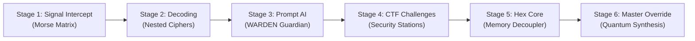

# 📡 FINAL OVERRIDE — 4 Question & Answer Sets, Team Allotment & Name Analysis

> **Event:** FINAL OVERRIDE (Timed Team Escape-Room Style Tech Challenge)  
> **Host:** Invictors Club, Department of Computer Science & Engineering, VVCE Mysuru  
> **Venue:** M Block 401 | **Total Registered Squads:** 23 Teams  

---

## 🎯 Executive Overview

To prevent screen-peeking, cross-squad whispering, and collusion across adjacent lab workstations, the 23 registered teams are partitioned into **4 balanced challenge sets (Set A, Set B, Set C, Set D)**. 

Each set maintains the **exact same cognitive difficulty, round mechanics, and solve time (45–60 mins total)**, but features **unique Morse waveforms, cipher pipelines, AI access keys, CTF station flags, memory hex matrices, and master verification checksums**.

---

## 📋 Master Question & Answer Sets (All 6 Stages)

### 🔵 Set A — Cosmic Vault Alpha
*Allotted to 6 Teams (Teams 01 – 06)*

| Stage | Mission & Interface | Clue / Encoded Input | Solved Output & Fragment | Notes for Coordinators |
| :--- | :--- | :--- | :--- | :--- |
| **Stage 1** | **Signal Intercept** (4-Sector Morse Matrix) | **S1 (Graph):** `—•` **S2 (Binary):** `———` **S3 (Blinker):** `•••—` **S4 (Waterfall):** `•—` | **`NOVA`** | Sector 1: `N` Sector 2: `O` Sector 3: `V` Sector 4: `A` |
| **Stage 2** | **Multi-Layer Decryption** (Cryptanalyst Suite) | `NGU1MDUwNTI0NjQ2MjA0MzU1NDU0ZTQ2NTIyMDU2NDYyMDRlNDg0NTQyNDU0ZTJlMjA1MzQ1NGU1NDVhNTI0MTQ3MjA0NzRhNDIyMDU2NDYyMDM3NTgzMjJlMjA1NjU0NDE0MjQ1NTIyMDRkNTI0NzRlMzkyZQ==` | **Access Phrase:** `AURORA` **Fragment 2:** **`7K2`** | 1. Base64 Decode 2. Hex to ASCII 3. ROT13 Shift *(Decoy `ZETA9` rejected)* |
| **Stage 3** | **Prompt WARDEN AI** (Offline Guardian) | **Required Rules:** 1. Access phrase `aurora` 2. Role (`technician/engineer/admin`) 3. Request fragment/code 4. Professional prompt &ge; 10 words | **`ORBIT`** | If prompted without role or phrase, WARDEN gives decoy `ZETA9`. Type verified piece `ORBIT`. |
| **Stage 4** | **CTF Challenges** (Security Control Room) | **Station 1 (Logs):** Odd clearance digit &rarr; `9` **Station 2 (Camera):** Contrast slider reveals &rarr; `1` **Station 3 (Audio):** Legend symbol match &rarr; `X` | **`91X`** | Solved in order: Station 1 + 2 + 3. Locks station inputs with green checks. |
| **Stage 5** | **Hexadecimal Memory Core** (6x4 Bus Decoupler) | **Column 1 Active Registers:** Channel A: `0x48` \| Channel B: `0x45` Channel C: `0x58` \| Channel D: `0x38` Channel E: `0x32` \| Channel F: `0x44` | **`HEX82D`** | Convert Hex byte stream `48 45 58 38 32 44` to ASCII text. |
| **Stage 6** | **Final Integration** (Master Quantum Synthesis) | **Assembly Order (A-Z by mission name):** 1. CTF: `91X` 2. Decoding: `7K2` 3. Hex: `HEX82D` 4. AI (Reversed): `TIBRO` *(ORBIT reversed)* 5. Signal: `NOVA` **Digit Sum:** 9+1+7+2+8+2 = **29** | **`FO{91X-7K2-HEX82D-TIBRO-NOVA}#29`** | Complete verification hash stops timer and outputs victory code. |

---

### 🟡 Set B — Cyber Nexus Beta
*Allotted to 6 Teams (Teams 07 – 12)*

| Stage | Mission & Interface | Clue / Encoded Input | Solved Output & Fragment | Notes for Coordinators |
| :--- | :--- | :--- | :--- | :--- |
| **Stage 1** | **Signal Intercept** (4-Sector Morse Matrix) | **S1 (Graph):** `•—••` **S2 (Binary):** `••—` **S3 (Blinker):** `—•` **S4 (Waterfall):** `•—` | **`LUNA`** | Sector 1: `L` Sector 2: `U` Sector 3: `N` Sector 4: `A` |
| **Stage 2** | **Multi-Layer Decryption** (Cryptanalyst Suite) | `NGU1MDUwNTI0NjQ2MjA0MzU1NDU0ZTQ2NTIyMDU2NDYyMDUwNGM0MzU1NTI0NTJlMjA1MzQ1NGU1NDVhNTI0MTQ3MjA0NzRhNDIyMDU2NDYyMDM0NWEzOTJlMjA1NjU0NDE0MjQ1NTIyMDRkNTI0NzRlMzkyZQ==` | **Access Phrase:** `CYPHER` **Fragment 2:** **`4M9`** | 1. Base64 Decode 2. Hex to ASCII 3. ROT13 Shift *(Decoy `ZETA9` rejected)* |
| **Stage 3** | **Prompt WARDEN AI** (Offline Guardian) | **Required Rules:** 1. Access phrase `cypher` 2. Role (`technician/engineer/admin`) 3. Request fragment/code 4. Professional prompt &ge; 10 words | **`SOLAR`** | WARDEN verifies access phrase `CYPHER` and releases fragment `SOLAR`. |
| **Stage 4** | **CTF Challenges** (Security Control Room) | **Station 1 (Logs):** Odd clearance digit &rarr; `8` **Station 2 (Camera):** Contrast slider reveals &rarr; `4` **Station 3 (Audio):** Legend symbol match &rarr; `Z` | **`84Z`** | Solved in order: Station 1 + 2 + 3 &rarr; `84Z`. |
| **Stage 5** | **Hexadecimal Memory Core** (6x4 Bus Decoupler) | **Column 1 Active Registers:** Channel A: `0x43` \| Channel B: `0x4f` Channel C: `0x52` \| Channel D: `0x45` Channel E: `0x37` \| Channel F: `0x46` | **`CORE7F`** | Convert Hex byte stream `43 4f 52 45 37 46` to ASCII text. |
| **Stage 6** | **Final Integration** (Master Quantum Synthesis) | **Assembly Order (A-Z by mission name):** 1. CTF: `84Z` 2. Decoding: `4M9` 3. Hex: `CORE7F` 4. AI (Reversed): `RALOS` *(SOLAR reversed)* 5. Signal: `LUNA` **Digit Sum:** 8+4+4+9+7 = **32** | **`FO{84Z-4M9-CORE7F-RALOS-LUNA}#32`** | Complete verification hash stops timer. |

---

### 🟢 Set C — Quantum Matrix Gamma
*Allotted to 6 Teams (Teams 13 – 18)*

| Stage | Mission & Interface | Clue / Encoded Input | Solved Output & Fragment | Notes for Coordinators |
| :--- | :--- | :--- | :--- | :--- |
| **Stage 1** | **Signal Intercept** (4-Sector Morse Matrix) | **S1 (Graph):** `•••—` **S2 (Binary):** `•` **S3 (Blinker):** `——•` **S4 (Waterfall):** `•—` | **`VEGA`** | Sector 1: `V` Sector 2: `E` Sector 3: `G` Sector 4: `A` |
| **Stage 2** | **Multi-Layer Decryption** (Cryptanalyst Suite) | `NGU1MDUwNTI0NjQ2MjA0MzU1NDU0ZTQ2NTIyMDU2NDYyMDQ5NDI0NTQ3NTI0YjJlMjA1MzQ1NGU1NDVhNTI0MTQ3MjA0NzRhNDIyMDU2NDYyMDMzNGIzODJlMjA1NjU0NDE0MjQ1NTIyMDRkNTI0NzRlMzkyZQ==` | **Access Phrase:** `VORTEX` **Fragment 2:** **`3X8`** | 1. Base64 Decode 2. Hex to ASCII 3. ROT13 Shift *(Decoy `ZETA9` rejected)* |
| **Stage 3** | **Prompt WARDEN AI** (Offline Guardian) | **Required Rules:** 1. Access phrase `vortex` 2. Role (`technician/engineer/admin`) 3. Request fragment/code 4. Professional prompt &ge; 10 words | **`TITAN`** | WARDEN verifies access phrase `VORTEX` and releases fragment `TITAN`. |
| **Stage 4** | **CTF Challenges** (Security Control Room) | **Station 1 (Logs):** Odd clearance digit &rarr; `7` **Station 2 (Camera):** Contrast slider reveals &rarr; `2` **Station 3 (Audio):** Legend symbol match &rarr; `Y` | **`72Y`** | Solved in order: Station 1 + 2 + 3 &rarr; `72Y`. |
| **Stage 5** | **Hexadecimal Memory Core** (6x4 Bus Decoupler) | **Column 1 Active Registers:** Channel A: `0x42` \| Channel B: `0x59` Channel C: `0x54` \| Channel D: `0x45` Channel E: `0x39` \| Channel F: `0x41` | **`BYTE9A`** | Convert Hex byte stream `42 59 54 45 39 41` to ASCII text. |
| **Stage 6** | **Final Integration** (Master Quantum Synthesis) | **Assembly Order (A-Z by mission name):** 1. CTF: `72Y` 2. Decoding: `3X8` 3. Hex: `BYTE9A` 4. AI (Reversed): `NATIT` *(TITAN reversed)* 5. Signal: `VEGA` **Digit Sum:** 7+2+3+8+9 = **29** | **`FO{72Y-3X8-BYTE9A-NATIT-VEGA}#29`** | Complete verification hash stops timer. |

---

### 🟣 Set D — Hyperion Vector Delta
*Allotted to 5 Teams (Teams 19 – 23)*

| Stage | Mission & Interface | Clue / Encoded Input | Solved Output & Fragment | Notes for Coordinators |
| :--- | :--- | :--- | :--- | :--- |
| **Stage 1** | **Signal Intercept** (4-Sector Morse Matrix) | **S1 (Graph):** `——` **S2 (Binary):** `•—` **S3 (Blinker):** `•—•` **S4 (Waterfall):** `•••` | **`MARS`** | Sector 1: `M` Sector 2: `A` Sector 3: `R` Sector 4: `S` |
| **Stage 2** | **Multi-Layer Decryption** (Cryptanalyst Suite) | `NGU1MDUwNTI0NjQ2MjA0MzU1NDU0ZTQ2NTIyMDU2NDYyMDQxNTI0ZjQ4NTk0ZTJlMjA1MzQ1NGU1NDVhNTI0MTQ3MjA0NzRhNDIyMDU2NDYyMDM1NDMzMzJlMjA1NjU0NDE0MjQ1NTIyMDRkNTI0NzRlMzkyZQ==` | **Access Phrase:** `NEBULA` **Fragment 2:** **`5P3`** | 1. Base64 Decode 2. Hex to ASCII 3. ROT13 Shift *(Decoy `ZETA9` rejected)* |
| **Stage 3** | **Prompt WARDEN AI** (Offline Guardian) | **Required Rules:** 1. Access phrase `nebula` 2. Role (`technician/engineer/admin`) 3. Request fragment/code 4. Professional prompt &ge; 10 words | **`ZENITH`** | WARDEN verifies access phrase `NEBULA` and releases fragment `ZENITH`. |
| **Stage 4** | **CTF Challenges** (Security Control Room) | **Station 1 (Logs):** Odd clearance digit &rarr; `6` **Station 2 (Camera):** Contrast slider reveals &rarr; `3` **Station 3 (Audio):** Legend symbol match &rarr; `K` | **`63K`** | Solved in order: Station 1 + 2 + 3 &rarr; `63K`. |
| **Stage 5** | **Hexadecimal Memory Core** (6x4 Bus Decoupler) | **Column 1 Active Registers:** Channel A: `0x42` \| Channel B: `0x49` Channel C: `0x54` \| Channel D: `0x53` Channel E: `0x31` \| Channel F: `0x45` | **`BITS1E`** | Convert Hex byte stream `42 49 54 53 31 45` to ASCII text. |
| **Stage 6** | **Final Integration** (Master Quantum Synthesis) | **Assembly Order (A-Z by mission name):** 1. CTF: `63K` 2. Decoding: `5P3` 3. Hex: `BITS1E` 4. AI (Reversed): `HTINEZ` *(ZENITH reversed)* 5. Signal: `MARS` **Digit Sum:** 6+3+5+3+1 = **18** | **`FO{63K-5P3-BITS1E-HTINEZ-MARS}#18`** | Complete verification hash stops timer. |

---

## 🎲 Team Allotment Mapping (23 Squads across 4 Sets)

### Set A (Teams 01 – 06)
- **Team 01:** `Trinetra`
- **Team 02:** `Bug Busters`
- **Team 03:** `TRIO_BYTE`
- **Team 04:** `Team Bhai`
- **Team 05:** `Cipher`
- **Team 06:** `Team Jupiter`

### Set B (Teams 07 – 12)
- **Team 07:** `Aèsir’s`
- **Team 08:** `Team onestop`
- **Team 09:** `Awake`
- **Team 10:** `Init`
- **Team 11:** `Syntax Andhre?`
- **Team 12:** `FAB-4`

### Set C (Teams 13 – 18)
- **Team 13:** `The Dynamos`
- **Team 14:** `CodeX`
- **Team 15:** `A³`
- **Team 16:** `Huntrix`
- **Team 17:** `Nexora`
- **Team 18:** `Tech titans`

### Set D (Teams 19 – 23)
- **Team 19:** `The Cosmos`
- **Team 20:** `THIRD EYE`
- **Team 21:** `Lap legends`
- **Team 22:** `Upside Downers`
- **Team 23:** `beginners`

---

## 5. Set E — Demo & Walkthrough Simulation

Reserved exclusively for presentation and exhibition walkthroughs:
- **Team Name:** `DEMO`
- **Default Members:** `D1`, `D2`, `D3`
- **Assigned Set:** `Set E`
- **Answers & Fragments:**
  - Stage 1: `ECHO` (Morse: • / —•—• / •••• / ———)
  - Stage 2: `2D5` (Access Phrase: `COSMOS`, Decoy: `DEMO0`)
  - Stage 3: `ALPHA` (Reversed: `AHPLA`)
  - Stage 4: `57W` (Station 1: `5` [L5] / Station 2: `7` / Station 3: `W` [circle])
  - Stage 5: `SYNC3C` (Column 1: `53 59 4E 43 33 43`)
  - Stage 6: `FO{57W-2D5-SYNC3C-AHPLA-ECHO}#22` (Digits: 5+7+2+5+3 = 22)

